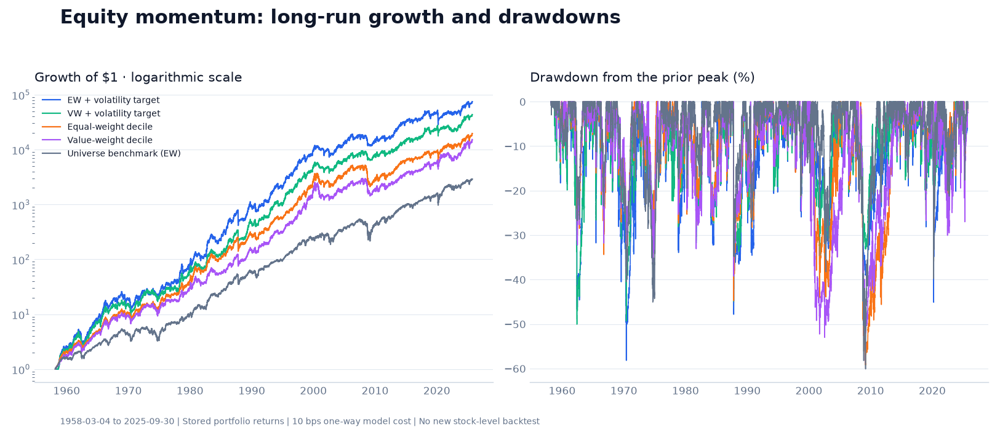
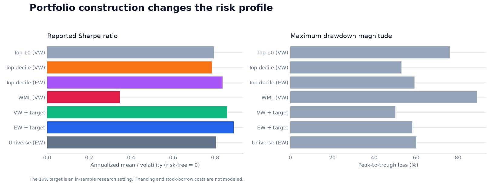
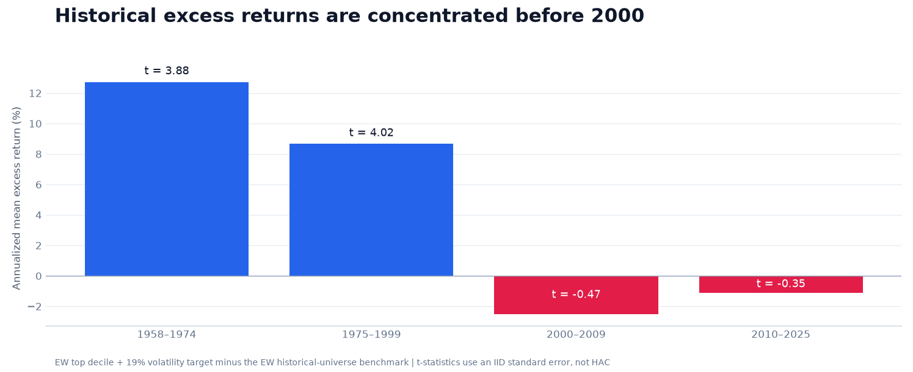
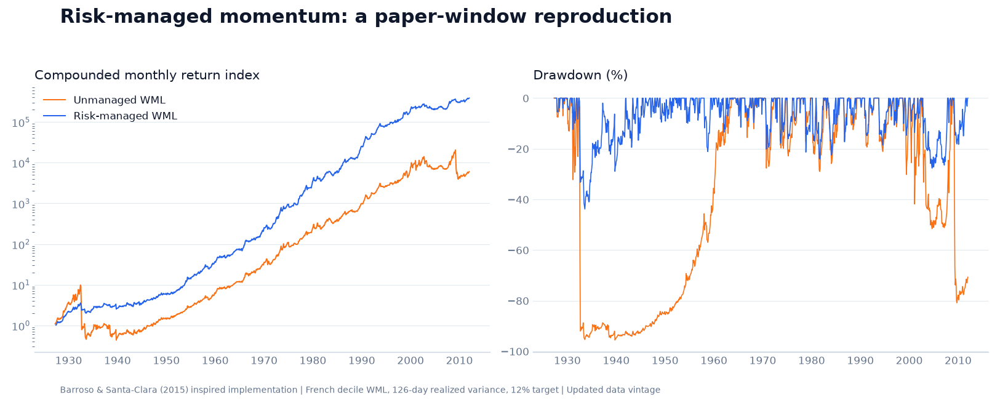
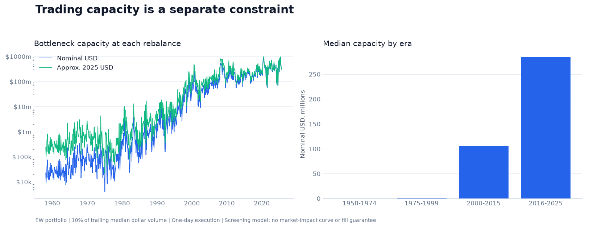

<div align="center">

# Momentum Is All You Need

**Equity momentum, portfolio breadth, volatility management and trading capacity.**


[Results](#results) · [Quick start](#quick-start) · [Methods](docs/METHODOLOGY.md) · [Data](docs/DATA.md) · [References](#references)

</div>

---

## Overview

How does a simple winner-selection signal change when we broaden the portfolio, use historical index membership, scale exposure by volatility, and account for trading capacity?

This repository brings together a short-sample exploratory study, a French-data risk-managed momentum reproduction, and a long-run CRSP portfolio comparison. It includes the MOM source code, its shared utilities, synthetic tests, aggregate result tables, and reproducible English figures.

```text
Historical membership + full stock-return history
                     ↓
          Skip-month momentum ranking
                     ↓
       Top-N / decile portfolio construction
                     ↓
     Costs · risk scaling · capacity screening
                     ↓
        Portfolio results and diagnostics
```

## Research design

| Component | Main comparison |
|---|---|
| Universe | Historical S&P 500 constituents, including available removed members |
| Signal | Past 252 trading days, excluding the latest 21 days |
| Portfolio | Top 10 stocks or top momentum decile; equal or capitalization weights |
| Trading | Monthly signal; next-trading-day close execution assumption |
| Costs | Fixed 10 bps one-way model charge; historical-cost sensitivity in source |
| Risk management | Lagged 126-day realized volatility, monthly exposure updates, leverage cap of 3 |
| Benchmark | Monthly rebalanced historical-universe equal-weight portfolio |
| Exported period | **4 March 1958–30 September 2025**, 17,008 daily observations |

The 252/21 signal is a trading-day approximation to skip-month momentum. The project is an implementation study and extension, rather than a claim to replicate an AQR product or every cited paper exactly.

## Results



The table below is verified against the bundled daily portfolio returns. **Annualized return is the arithmetic daily mean × 252, not CAGR**. The long-only Sharpe convention uses a zero risk-free rate.

| Portfolio | Annualized mean return | Volatility | Sharpe | Max. drawdown |
|---|---:|---:|---:|---:|
| Top 10 stocks, value weighted | 22.94% | 28.87% | 0.795 | −75.88% |
| Top decile, value weighted | 16.45% | 20.96% | 0.785 | −53.00% |
| Top decile, equal weighted | 16.64% | 19.92% | 0.835 | −59.22% |
| Winner-minus-loser, value weighted | 7.87% | 22.76% | 0.346 | −89.03% |
| Top decile, VW + 19% volatility target | 18.04% | 21.06% | 0.857 | −50.07% |
| Top decile, EW + 19% volatility target | 18.90% | 21.25% | 0.889 | −58.19% |
| Historical-universe benchmark, EW | 13.16% | 16.39% | 0.803 | −60.11% |

Source: [final_summary.csv](results/final_summary.csv). These are stored research outputs; the packaging checks recomputed their metrics from the portfolio series, without rerunning the full stock-level backtest.



### Where does the excess return come from?



For the scaled equal-weight decile, annualized mean excess return over the equal-weight universe benchmark was **+12.72 percentage points in 1958–1974**, **+8.66 points in 1975–1999**, **−2.53 points in 2000–2009**, and **−1.12 points in 2010–2025**. The t-statistics shown use IID standard errors, not a HAC estimator.

The full-sample result therefore does not establish continuing excess returns. The target-volatility setting was explored in-sample, and the early-period fixed-cost assumption is optimistic. See [methodology](docs/METHODOLOGY.md) for the metric, selection and execution assumptions.

### Risk-managed momentum: paper-oriented comparison

The reproduction module uses Kenneth French winner-minus-loser deciles and a lagged volatility estimate, following the risk-management idea in [Barroso & Santa-Clara (2015)](https://doi.org/10.1016/j.jfineco.2014.11.010).



| Recorded paper window, March 1927–December 2011 | Sharpe | Worst month | Max. drawdown |
|---|---:|---:|---:|
| Unmanaged WML | 0.542 | −77.66% | −95.56% |
| Risk-managed WML | 0.996 | −24.16% | −43.83% |

This uses the available French data vintage and its own monthly/risk-free conventions. It is a paper-window reproduction attempt, not an exact archival match or the same strategy as the long-only S&P 500 extension. [Recorded monthly summary](results/barroso_summary.csv).

### Capacity: performance is only one constraint



For the equal-weight scaled strategy, the stored 2016–2025 bottleneck-capacity median is approximately **$285 million**, assuming **10% of trailing median dollar volume** and **one-day execution**. Early-era nominal capacity is much smaller: about **$45,000** in 1958–1974.

These are volume-based screening estimates, not guaranteed executable AUM. The model omits a calibrated market-impact curve and has simplified target-weight/leverage-turnover handling. [Capacity table](results/capacity_summary.csv) · [Model limitations](docs/METHODOLOGY.md#capacity-model).

## Quick start

### 1. View and regenerate the included figures

No CRSP credentials are needed for this route:

```bash
git clone https://github.com/Haoyu-tech/Momentum-is-all-you-need.git
cd Momentum-is-all-you-need
python -m pip install -r requirements.txt
python scripts/plot_results.py
```

The script reads aggregate CSVs under `results/`, renders five English PNG/SVG figures, and checks the summary metrics against the daily return series.

### 2. Run the synthetic tests

```bash
python -B -m unittest discover -s why/mom/tests -t .
```

**85 existing tests passed locally** during packaging. They cover skip-month signal timing, rebalance/trade alignment, universe parsing, risk-scaling look-ahead checks, hedging costs and capacity arithmetic. GitHub Actions is configured to run the test suite and figure checks.

### 3. Rebuild a stock-level experiment

Supply your authorized CRSP exports and follow [the data guide](docs/DATA.md):

```bash
python scripts/prepare_crsp.py --members /path/to/constituents.zip --stocks /path/to/daily_stock.zip --with-volume
python -m why.mom.final --plot ""
python -m why.mom.capacity --plot ""
python scripts/export_results.py
python scripts/plot_results.py
```

Raw CRSP/Databento inputs, credentials and stock-level caches are not included. The original package layout is retained so module imports work independently of the larger competition workspace.

## Project map

| Path | Purpose |
|---|---|
| [why/mom/](why/mom/) | Signal, portfolios, risk management, CRSP loading and capacity analysis |
| [why/mom/tests/](why/mom/tests/) | Existing synthetic regression tests |
| [why/factors/](why/factors/) | Shared holding-period and metric utilities |
| [scripts/](scripts/) | Portable data preparation and English figure rendering |
| [results/](results/) | English aggregate output tables and provenance |
| [assets/](assets/) | README figures |
| [docs/](docs/) | Data, methods, citations and BibTeX |

## Interpretation limits

- Historical membership avoids a current-members-only snapshot, but the sector map is not a complete point-in-time classification history.
- Missing holding-period returns are filled with zero; delisting and export conventions still need an empirical-data audit.
- Fees use simplified rebalance accounting. Financing, borrow costs, impact and benchmark trading costs are not modeled consistently.
- In-sample configuration exploration and a fixed cost rate across decades limit performance inference.
- The included figures are regenerated from saved aggregates. A full CRSP backtest was not rerun during publication.

## References

- **Jegadeesh & Titman (1993)** — past-return ranking and momentum evidence. [The Journal of Finance](https://onlinelibrary.wiley.com/doi/abs/10.1111/j.1540-6261.1993.tb04702.x).
- **Moskowitz & Grinblatt (1999)** — industry effects in momentum. [The Journal of Finance](https://onlinelibrary.wiley.com/doi/full/10.1111/0022-1082.00146).
- **Barroso & Santa-Clara (2015)** — risk-managed momentum. [Journal of Financial Economics](https://www.sciencedirect.com/science/article/abs/pii/S0304405X14002566).
- **Daniel & Moskowitz (2016)** — momentum crashes. [Journal of Financial Economics](https://doi.org/10.1016/j.jfineco.2015.12.002).
- **Kenneth French Data Library** — prior-return portfolio construction. [Data documentation](https://mba.tuck.dartmouth.edu/pages/faculty/ken.french/Data_Library/det_10_port_form_pr_12_2.html).

[Full bibliography and implementation mapping](docs/REFERENCES.md) · [BibTeX](docs/references.bib)

<sub>Research code and historical evidence. The repository title is a research theme, not a promise of investment performance.</sub>
